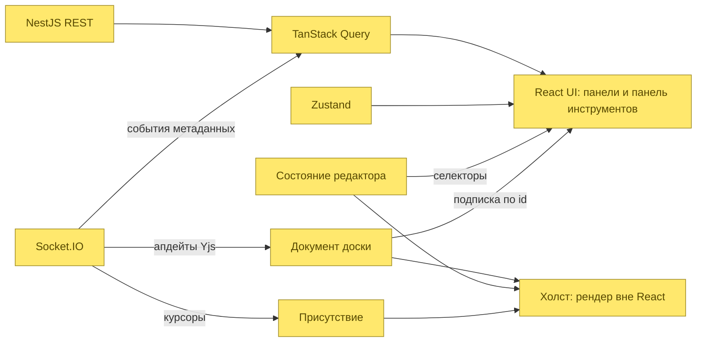
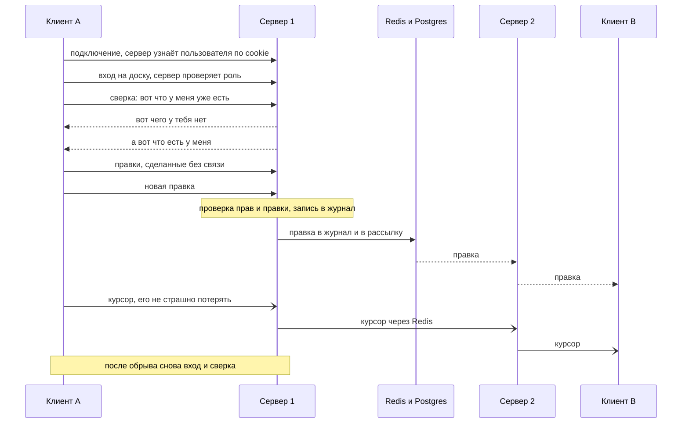

# Архитектура фронтенда

Обзорный фрейм «Архитектура на одном экране» есть только на доске, поэтому разделы здесь начинаются со второго.

Текст доски архитектуры фронтенда, выгружен 12.11.2026. Оригинал со схемами: [доска в Miro](https://miro.com/app/board/uXjVEPt8zo4=/). У карточек строка «Статус»: «Рекомендуем» (наше предложение), «Решить с командой» (ждёт решения), «Принято» (решено, есть ADR), «Грабли» (частая ошибка); на самой доске плашек статусов нет. Если текст расходится с ADR в [docs/adr](../adr/README.md), верен ADR. Файл не правим руками: меняется доска, выгрузку обновляем.

## 2. Что из ТЗ следует для фронта

Требования ТЗ, которые влияют на архитектуру, и как мы их закрываем. В «кавычках» цитаты ТЗ, без кавычек пересказ. Номер справа ведёт в раздел с подробностями.

### Требование ТЗ

### Как закрываем

### Раздел

«Состояние интерфейса, содержимое доски и данные с сервера должны иметь понятные зоны ответственности»

Делим состояние на пять зон: данные с сервера (TanStack Query), документ доски, состояние редактора в движке, присутствие и интерфейс (Zustand). Содержимое доски не копируем ни в кэш запросов, ни в состояние React.

6

«Перемещение курсора одного участника не должно вызывать перерисовку всего приложения»

Чужие курсоры хранятся вне React и рисуются своим слоем холста. Компонент React подписан на элемент по id и обновляется, только когда тот меняется.

6, 7

Совместная правка: слать всю доску недостаточно; продумать правку одного элемента двумя людьми, удаление при чужой правке и возврат после обрыва

По сети уходят только изменения (апдейты Yjs), а не вся доска. Как доска ведёт себя в трёх сценариях из ТЗ, показано в таблице раздела 8.

8

«Повторная доставка одного и того же события не должна создавать дубли элементов или повторно применять изменение»

Одно и то же изменение доски можно получить дважды, результат не изменится: так устроен Yjs. Остальные действия (комментарии, ИИ, приглашения) несут ключ, который при повторной отправке не меняется, и сервер не выполнит их дважды.

8

После потери соединения доска приходит в актуальное состояние

После переподключения клиент снова входит на доску, сверяется с сервером, и стороны досылают друг другу недостающие изменения. Пользователь видит статус связи.

8, 9

Отмена и повтор своих действий: отмена одного не отменяет работу другого

Отмена откатывает только ваши действия, чужие не трогает. Перетаскивание записывается один раз, когда отпустили мышь, поэтому отменяется одним шагом.

7, 8

История версий: посмотреть и восстановить, пока другие работают на доске

Версии хранит сервер. Восстановление записывается как новое изменение поверх текущей доски: все видят обычную правку и уведомление, история отмены у всех очищается.

9

Роли владелец, редактор, наблюдатель; приглашение по ссылке с правами и отзыв доступа

Роль приходит с сервера: наблюдатель видит доску, но редактировать не может. Права всё равно проверяет бэк на каждом запросе и событии сокета.

9

Результат ИИ сначала показываем на проверку, потом применить или отказаться

Превью рисуем отдельным слоем вне документа. «Применить» выполняется одной транзакцией и даёт один шаг отмены.

9

Экспорт в изображение: вся доска или выбранная область

Движок рисует нужную область вне экрана и отдаёт PNG. Картинки грузим с crossOrigin, а S3 отдаёт их с CORS: иначе браузер не даст сохранить PNG.

7, 9

Комментарии к элементу или месту на доске, ответы, отметка обсуждения решённым

Комментарии грузим по REST в TanStack Query и обновляем по событиям сокета. Комментарий привязан к элементу или к точке на доске.

9

Изображения на доске, файлы в S3, обработка файлов фоновыми задачами

Картинку проверяем по размеру ещё до загрузки. Файл лежит в S3, элемент на доске хранит его id, а пока файл не готов, видна заглушка.

7, 9

Мультивыделение, перемещение группой, копирование и удаление; группы

Копирование делает модуль clipboard: копии получают новые id, а скопированные стрелки и группы цепляются к копиям, а не к оригиналам.

7

«Продумайте ограничения на размер файлов, количество элементов и запросы к ИИ»

Лимиты записаны в общем пакете contracts: фронт проверяет их ещё до отправки, сервер проверяет всегда. Сами числа согласуем с бэком.

5

Бесконечный холст: перемещение и масштаб удобны даже на больших досках

Через пространственный индекс рисуем только видимое.

7

Совместная работа пользователей на разных инстансах бэкенда

Подключаемся только по WebSocket, серверы пишут изменения в журнал в Postgres и рассылают друг другу через Redis: неважно, к какому серверу подключён пользователь. Проверим в прототипе.

8

Методология: «Feature sliced design»; «Обязательный линтинг + линтер на правила соблюдения FSD»

Предлагаем облегчённый FSD 2.1, его правила проверяет Steiger отдельным шагом CI.

3

«Минимум кастомных стилей по месту, используем разработанный UI kit»

Готовые компоненты shadcn лежат в shared/ui, цвета и отступы задаются переменными Tailwind, примеры компонентов смотрим в Storybook.

3

Тесты хотя бы на основной функционал, ревью каждой задачи, CI на каждый PR: линтеры, тесты, сборка, typecheck

CI на каждый PR: линт и формат (oxlint, oxfmt), FSD (Steiger), типы (tsc), тесты (Vitest), сборка (Turborepo). В develop и main попадаем только через PR с ревью. Ядро движка тестируется без браузера.

## 3. FSD в Next.js

Раскладка по официальному гайду FSD для Next.js (правка от 08.06.2026): слои _app и _pages в src/, маршруты Next в корневой app/. Рендеринг и вход: раздел 4.

**apps/web**

```text
apps/web/
├─ app/                          маршруты Next, только ре-экспорты
│  ├─ layout.tsx                 -> @/_app/layouts (корень)
│  ├─ (marketing)/page.tsx       -> @/_pages/landing
│  ├─ (auth)/login/page.tsx      -> @/_pages/login
│  ├─ (auth)/register/page.tsx   -> @/_pages/register
│  ├─ (app)/layout.tsx           -> @/_app/layouts (каркас)
│  ├─ (app)/w/page.tsx           -> @/_pages/workspaces
│  ├─ (app)/w/[workspaceId]/page.tsx        -> @/_pages/workspace
│  ├─ (app)/w/[workspaceId]/trash/page.tsx  -> @/_pages/trash
│  ├─ (app)/settings/page.tsx    -> @/_pages/settings
│  ├─ b/[boardId]/page.tsx       -> @/_pages/board
│  └─ invite/[token]/page.tsx    -> @/_pages/invite
├─ proxy.ts                      редирект без сессии, не проверка прав
├─ instrumentation.ts            Sentry на сервере
├─ instrumentation-client.ts     Sentry в браузере
└─ src/
   ├─ _app/      providers, layouts, styles
   ├─ _pages/    landing, login, register, workspaces,
   │             workspace, trash, settings, board, invite
   ├─ widgets/   app-shell (боковое меню и шапка)
   ├─ features/  на старте пусто; кандидаты:
   │             rename-board, share-board
   ├─ entities/  session, user, workspace, board
   └─ shared/    api, ui, lib, config, routes
```

### Слои: импорт только в слои ниже

_app

Провайдеры (TanStack Query, сессия, тема), раскладки для layout.tsx, глобальные стили. Сегмента ui нет.

_pages

Страницы целиком: лендинг, вход, регистрация, пространства, корзина, настройки, доска, приглашение.

widgets

Крупные блоки на двух и более страницах: app-shell (боковое меню и шапка).

features

Действия на двух и более страницах: rename-board и share-board (список досок и сама доска).

entities

Понятия, нужные нескольким страницам: session, user, workspace, board.

shared

Без бизнес-смысла: api (HTTP, сокет, запросы), ui (shadcn), lib, config, routes.

**Маршруты и ленивая загрузка доски**

```typescript
// app/b/[boardId]/page.tsx: одна строка
export { BoardPage as default } from '@/_pages/board'

// app/(app)/w/[workspaceId]/error.tsx
'use client'
export { WorkspaceError as default } from '@/_pages/workspace'

// src/_pages/board/ui/board-page.tsx
'use client'
const BoardEditor = dynamic(() => import('./board-editor'), { ssr: false })
```

### Маршрут: одна строка

Статус: Рекомендуем.

Файлы маршрута в app/ (page, loading, error, not-found) только отдают Next готовый компонент из _pages, а layout.tsx берёт раскладку из _app/layouts. В error.tsx первой строкой 'use client': Next требует, чтобы он был клиентским. Можно ли так же отдавать настройки маршрута (dynamic, revalidate), проверим на каркасе.

### Серверный код отдельно

Статус: Рекомендуем.

Код, который работает только на сервере (например, загрузка данных для серверных компонентов), слайс отдаёт через отдельный index.server.ts с import 'server-only'. Если такой код по ошибке импортируют в браузерный компонент, сборка остановится с ошибкой, а не утащит серверный код в браузер.

### Публичный API слайса

Статус: Рекомендуем.

Снаружи слайса можно брать только то, что он явно выставил в своём index.ts. export * не используем, чтобы было видно, что именно открыто. Внутри слайса файлы импортируют друг друга по относительным путям, а другие слайсы подключаются через алиас @/.

### Сначала код внутри страницы

Статус: Рекомендуем.

Новый код сначала живёт в папке своей страницы: доска с панелями в _pages/board, создание доски и приглашение участника в _pages/workspace. В общие слои (widgets, features, entities) переносим только то, что понадобилось второй странице. Если вынести раньше, Steiger подскажет, что слайс используется в одном месте.

### Чего не заводим

Статус: Рекомендуем.

Папки по типу файла (components, hooks, types, helpers) и общую shared/types не заводим: FSD делит код по смыслу, а не по виду файла. Тип или схема лежат рядом с кодом, который ими пользуется. Слой processes в FSD устарел, его тоже не берём.

### shadcn в shared/ui

Статус: Рекомендуем.

shadcn кладёт компоненты в shared/ui, а утилиты и хуки в shared/lib: это задаётся в components.json. Каждый компонент лежит отдельным файлом, например shared/ui/button.tsx, без общего index.ts: иначе dev-сервер грузил бы все компоненты разом и работал медленнее.

### Линтер FSD: Steiger

Статус: Рекомендуем.

Steiger проверяет правила FSD: кто кого импортирует, нет ли обхода index.ts, нет ли лишних слайсов. Он ещё в бете, поэтому версии закрепляем точно: steiger 0.10.0 и плагин 0.8.2, нужен Node от 22.18. Запускается отдельным шагом в CI, есть расширение для редактора.

### Грабли Next и Steiger

Статус: Грабли.

Не создаём пустую папку pages/, как советовали старые гайды FSD: Next решит, что используется ещё и старый роутер, и хуки навигации начнут возвращать значения с возможным null. А Steiger по ошибке ругается на import() внутри next/dynamic, если модуль из другого слайса: это известный баг, такие места отмечаем в PR.

## 4. Next.js: рендеринг и вход

Доска работает целиком в браузере. На остальных страницах каркас рисует сервер, а данные догружаются в браузере через TanStack Query.

### Адрес

### Где собирается страница

### Откуда данные

/ (лендинг)

Сервер собирает страницу один раз заранее: она одна для всех и открывается сразу

Личных данных нет

/login, /register: вход и регистрация

Формы работают в браузере: React Hook Form, поля проверяются по схемам из contracts

Форма отправляется на бэк через TanStack Query

/w: мои пространства; /w/[workspaceId]: доски пространства; /w/[workspaceId]/trash: корзина

Каркас страницы рисует сервер, списки догружаются в браузере

TanStack Query. Загружать данные заранее на сервере будем потом

/settings: профиль и подключение Telegram

Формы работают в браузере

Загрузка и сохранение через TanStack Query

/b/[boardId]: сама доска

Целиком в браузере: на сервере холсту делать нечего, поэтому редактор подключаем только в браузере (next/dynamic, ssr: false)

Название и права доски через REST, содержимое и курсоры через сокет

/invite/[token]: приглашение по ссылке

Сервер проверяет ссылку и показывает, на какую доску и с какими правами зовут. Кнопка «Принять». Если не вошёл, сначала вход, потом возврат сюда

Не кэшируем: ссылку могут отозвать в любой момент

### Сессия в httpOnly cookie

Статус: Рекомендуем.

После входа бэк кладёт в браузер две cookie: короткий токен доступа (access) и долгий токен обновления (refresh). Из JavaScript их не прочитать (HttpOnly), поэтому чужой скрипт их не украдёт. Уходят они только по HTTPS и только с нашего сайта (Secure, SameSite). Refresh при каждом обновлении меняется на новый.

### Один домен

Статус: Принято.

Сайт и API живут на одном адресе. Caddy (обратный прокси) смотрит на путь: /api и /socket.io отправляет в Nest, остальное в Next. Поэтому браузер сам прикладывает cookie к запросам в API, и доступ с другого домена (CORS) настраивать не нужно.

### proxy.ts

Статус: Рекомендуем.

Срабатывает до открытия любой страницы. Если cookie входа нет, отправляем на /login, а после входа возвращаем туда, куда человек шёл. Это удобство, а не защита: права всё равно проверяет бэк на каждом запросе, так советует и документация Next.

### Обновление сессии

Статус: Рекомендуем.

Токен доступа живёт недолго. Когда бэк отвечает 401, вкладка один раз обновляет токены, и для запросов, и для сокета. Несколько вкладок обновляют их по очереди (navigator.locks): иначе две вкладки одновременно потратили бы один refresh, и одна вылетела бы из аккаунта.

### Сокет

Статус: Рекомендуем.

В каждой вкладке одно подключение к сокету, и создаётся оно только в браузере. Cookie входа браузер отправляет при подключении сам. Если сервер отказал из-за устаревшего токена, вкладка обновляет токены той же функцией, что и для запросов, и подключается заново.

### Cache Components

Статус: Решить с командой.

Новый проект на Next 16.4 сразу включает новую модель кэширования (cacheComponents и partialPrefetching). Наше приложение почти всё работает в браузере: выигрыша она почти не даст, а разбираться в ней придётся. В первой версии выключаем оба флага, вернёмся к ним при переходе на Next 17.

### Zustand в Next

Статус: Рекомендуем.

Хранилище Zustand создаём заново для каждой открытой доски и каждого запроса к серверу и передаём через React-контекст. Если сделать его одним на всё приложение, при отрисовке на сервере данные одного пользователя могли бы попасть на страницу другого: сервер один на всех.

### QueryClient

Статус: Рекомендуем.

QueryClient хранит кэш загруженных данных. На сервере создаём новый на каждый запрос, чтобы данные разных пользователей не смешались. В браузере он один на всё приложение, чтобы кэш не терялся при переходах. Так советует документация TanStack Query (функция getQueryClient).

## 5. Общие типы и контракты

Контракт здесь значит договорённость о данных: что фронт, бэк и воркер отправляют друг другу и в каком виде. Все контракты лежат в одном пакете packages/contracts и описаны на Zod. Одно описание сразу даёт и проверку данных, и тип TypeScript, поэтому стороны не расходятся.

**packages/contracts**

```text
packages/contracts/src/
├─ common/  общее: id, роли (владелец, редактор, наблюдатель) и их права,
│           лимиты (размер файла, число элементов, запросы к ИИ),
│           коды ошибок, постраничная загрузка
├─ http/    запросы и ответы API по разделам: вход, пространства, участники,
│           доски, комментарии, версии, приглашения, файлы, ИИ
├─ ws/      события сокета: как называются, что в них лежит, номер версии протокола
├─ board/   элементы доски: стикер, фигура, текст, картинка, стрелка, группа;
│           их стили, размеры и положение
└─ ai/      что возвращает ИИ и как выглядит превью его правок
```

**Как описан элемент доски (пример: стикер)**

```typescript
// packages/contracts/src/board/element.ts
export const StickySchema = z.object({
  id: ElementId,
  type: z.literal('sticky'),
  x: z.number(), y: z.number(), w: z.number(), h: z.number(),
  text: z.string().max(5000),
  color: StickyColor,
  index: z.string(),              // порядок слоёв: кто лежит поверх кого
  parentId: ElementId.nullable(), // в какой группе лежит элемент
})

export const ElementSchema = z.discriminatedUnion('type', [
  StickySchema, ShapeSchema, TextSchema,
  ImageSchema, ConnectorSchema, GroupSchema,
])
// тип TypeScript получаем из схемы, руками не пишем
export type BoardElement = z.infer<typeof ElementSchema>
```

**События сокета (часть списка)**

```typescript
// packages/contracts/src/ws/events.ts
export interface ClientToServerEvents {
  'board:join': (p: JoinBoard, ack: (r: JoinResult) => void) => void
  'board:sync': (p: SyncMessage) => void        // сверка: у кого каких правок нет
  'board:update': (p: BoardUpdate) => void
  'presence:cursor': (p: CursorPosition) => void  // можно терять, следующий догонит
  'presence:state': (p: PresenceStatePatch) => void
}
export interface ServerToClientEvents {
  'board:sync': (p: SyncMessage) => void
  'board:update': (p: BoardUpdate) => void
  'presence:cursor': (p: RemoteCursor) => void    // можно терять, следующий догонит
  'presence:state': (p: PresenceState) => void    // кто вошёл или вышел
  'presence:snapshot': (p: PresenceState[]) => void
  'access:changed': (p: AccessChanged) => void    // сменилась роль или отозвали доступ
  'comment:changed': (p: CommentEvent) => void
  'ai:job-finished': (p: { jobId: string }) => void
  'board:version-restored': (p: VersionRestored) => void
}
// на фронте: Socket<ServerToClientEvents, ClientToServerEvents>
```

### Как пользуется фронт

Статус: Рекомендуем.

Все запросы к API лежат в shared/api: отдельный файл для досок, для комментариев и так далее. Типы для них берём из contracts. Форма проверяет поля той же схемой, что и бэк, поэтому ошибку пользователь видит сразу, ещё до отправки. Сообщения из сокета тоже сначала проверяем схемой и только потом используем.

### Как пользуется бэк

Статус: Принято.

Бэк проверяет каждый входящий запрос теми же схемами, что и фронт.

В NestJS 12 для этого есть встроенная проверка, и из этих же схем собирается документация Swagger. В NestJS 11 понадобится пакет nestjs-zod. Какую версию NestJS брать, решает бэк.

### Как бэк проверяет правки доски

Статус: Рекомендуем.

Правку доски нельзя проверить схемой, как обычный запрос. Поэтому сервер сначала смотрит, для какой она доски и не слишком ли большая, а потом применяет её к копии доски и проверяет результат: все элементы проходят схему, и доска укладывается в лимиты. Если нет, правку отклоняем.

### Схемы, понятные ИИ и Swagger

Статус: Рекомендуем.

Из схем автоматически получается описание для ИИ (в каком виде модель должна ответить) и документация Swagger. Поэтому в схемах нет того, что так не переводится: даты передаём строкой в формате ISO, а не объектом Date, и не добавляем преобразований (transform). Для ответов ИИ делаем отдельные простые схемы, без глубокой вложенности.

### Как менять контракт

Статус: Рекомендуем.

Если меняем данные, которыми обмениваются фронт и бэк, новые поля только добавляем, а старые не удаляем и не переименовываем. Иначе сломается та сторона, которая ещё не обновилась. Поэтому сначала выкатываем бэк, потом фронт. В сообщениях сокета передаём номер версии, чтобы вкладки, открытые до обновления, не ломались.

### Где во фронте лежат типы

Статус: Рекомендуем.

Типы данных с сервера берём из contracts и используем рядом с запросами в shared/api. Типы, которые нужны только интерфейсу, держим в папке model своего слайса, а типы пропсов прямо рядом с компонентом. Служебные типы берём готовыми из библиотеки type-fest, а общие объявления для всего приложения (файлы .d.ts) кладём в _app.

### TypeScript 6.0, не 7

Статус: Грабли.

Свежий TypeScript уже 7, но инструменты NestJS (Nest CLI и плагин Swagger) с ним пока не работают. Поэтому во всём репозитории держим TypeScript 6.0, версия задана в одном месте (pnpm catalog).

### Чего не делаем

Статус: Грабли.

Не заводим общую папку shared/types: у каждого типа есть своё место. Не генерируем клиент из Swagger: типы уже есть в contracts, и вышло бы два описания одних и тех же данных. Элементы доски не перекладываем в свои промежуточные модели: у элемента один тип, из contracts.

## 6. Зоны состояния

ТЗ: «Состояние интерфейса, содержимое доски и данные с сервера должны иметь понятные зоны ответственности». У каждой зоны свой владелец и свой путь обновления.

### Данные с сервера

TanStack Query

Что лежит. Пользователь, пространства, участники и роли, списки досок с поиском и фильтрами, корзина, метаданные доски, комментарии, версии, приглашения, результаты ИИ по jobId.

Чем обновляется. REST через queryOptions в shared/api. События сокета вызывают invalidateQueries или setQueryData.

Чего здесь нет. Элементов доски.

### Документ доски

Y.Doc в движке

Что лежит. Элементы, стрелки и их привязки, группы, порядок слоёв.

Чем обновляется. Транзакциями движка и апдейтами Yjs с сервера. Компоненты подписаны на конкретный id через useSyncExternalStore.

Чего здесь нет. Копий в Query, useState или Zustand: менять доску только через движок.

### Состояние редактора

самописный движок, работает вне React

Что лежит. Камера, выделение, текущий инструмент, редактируемый элемент, статус связи.

Чем обновляется. Жестами пользователя, каждый кадр. React читает только то, что показывает: масштаб, число выделенных.

Чего здесь нет. Синхронизации и отмены: у каждого участника своё.

### Присутствие

свой стор, вне React

Что лежит. Чужие курсоры, кто на доске, кто что выделил или редактирует, чужие тащимые элементы.

Чем обновляется. Курсоры volatile-событиями раз в 30-50 мс с плавной интерполяцией. Вход, выход и «редактирует» отдельным надёжным событием.

Чего здесь нет. Данных документа: курсоры попали бы в отмену и в версии.

### Интерфейс

Zustand

Что лежит. Открытые панели, модалки, настройки вида, флаги режимов: превью ИИ (jobId), просмотр версии (versionId).

Чем обновляется. Действиями пользователя. Стор доски создаётся через контекст при входе на доску.

Чего здесь нет. Данных с сервера и содержимого доски.

**Потоки данных**



### Перетаскивание

Статус: Рекомендуем.

Пока элемент тащат, по экрану едет его копия, а документ не меняется. Другие видят движение так же, как курсоры. Итоговое место пишем в документ один раз, когда мышь отпустили.

### У каждого пользователя своя камера

Статус: Рекомендуем.

Перемещение и масштаб не передаются другим и не попадают в отмену. Индикатор масштаба в интерфейсе подписан на камеру селектором.

### Данные превью ИИ

Статус: Рекомендуем.

Результат задачи ИИ хранится на бэке по jobId и читается через TanStack Query. В Zustand только флаг режима превью, в документ превью не попадает.

## 7. Движок доски

Наш пакет packages/board-engine: модули движка, граница с Konva и слои отрисовки. Движок не знает про React, роли, рабочие пространства и сеть: права приходят флагом readOnly.

### model

Элементы доски по id. Любое изменение идёт транзакцией с пометкой «моё» или «чужое из сети», после неё движок знает, какие элементы поменялись. Как элементы лежат в Yjs, описано в пакете board-doc, общем с сервером.

### undo

Отмена и повтор только своих действий: чужие правки не откатываются. Это не история версий, она в разделе 9.

### camera

Сдвиг и масштаб вида, перевод точки на экране в точку на доске и обратно. У каждого участника своя, другим не передаётся.

### spatial

Быстрый поиск «какие элементы в этом прямоугольнике». Нужен, чтобы рисовать только видимое, для рамки выделения, области для ИИ и экспорта и чтобы стрелка прилипала к ближайшему элементу.

### ordering

Что лежит поверх чего. Порядок задаём дробными числами: чтобы положить элемент между 1 и 2, даём ему 1,5 и не перенумеровываем остальные. Если двое вставили в одно место, спор решает id.

### bindings

Стрелки, привязанные к элементам. Стрелка хранит id элемента и точку крепления, а форму считаем при отрисовке, поэтому при сдвиге блока стрелка едет сама. Удалили блок: конец стрелки повисает.

### tools

Инструменты: выделение, рука, стикер, фигура, текст, картинка, стрелка. Инструмент «комментарий» сделан в приложении: движок только сообщает, куда кликнули, а форму и сохранение на сервер делает приложение.

### clipboard

Копирование, вставка и дублирование. Копии получают новые id, а стрелки и группы внутри скопированного цепляются к копиям, а не к оригиналам. Всё одним шагом отмены.

### elements

Справочник типов: стикер, фигура, текст, картинка, стрелка, группа. Для каждого: как считать границы, как рисовать и экспортировать. Схемы берём из contracts, новый тип добавляем здесь.

### render

Рисует доску на экране и делает экспорт в PNG. Konva подключена только здесь. Изменения копим и рисуем разом, раз в кадр. Рисуем то, что в документе; элемент, который сейчас тащат, рисуется отдельно поверх остальных.

### text

Текст редактируем в обычном HTML-поле поверх холста: на canvas поле ввода не сделать. Текст хранится строкой, поэтому пока один редактирует, у других редактор закрыт («редактирует Иван»).

### sync

Интерфейс для сети с тремя действиями: «отправить моё изменение», «принять чужое», «загрузить доску целиком». Сокет к нему подключает приложение, сам движок про сеть не знает.

**Всё, что движок просит у Konva (её можно заменить)**

```typescript
// packages/board-engine/src/render/renderer.ts
export interface BoardRenderer {
  mount(container: HTMLElement): void
  destroy(): void
  load(elements: BoardElement[]): void           // начальная загрузка
  applyDiff(diff: DocumentDiff): void            // рисуем из документа
  setCamera(camera: Camera): void
  setSelection(ids: ElementId[]): void
  setPresence(cursors: RemoteCursor[]): void     // слой курсоров
  setPreview(preview: AiPreview | null): void    // add, update, remove
  onPointer(cb: (e: WorldPointerEvent) => void): () => void
  onTransformEnd(cb: (ids: ElementId[], t: Transform) => void): () => void
  exportImage(options: ExportOptions): Promise<Blob>
}
```

### Слои отрисовки сверху вниз

Экранный слой: пины комментариев, контекстное меню, панель ИИ. Не масштабируются вместе с доской.

HTML-редактор текста: поле ввода поверх холста. Подстраивается под текущий масштаб, чтобы при правке текст выглядел так же, как на доске.

Курсоры: чужие курсоры и элементы, которые тащат другие. Обновляются раз в кадр.

Интерактив: рамка выделения, ручки, элемент, который сейчас тащим, превью ИИ.

Контент: все элементы документа. Перерисовываются, когда меняется документ или камера.

### Konva

Статус: Грабли.

Konva тратит ресурсы даже на элементы вне видимой части доски, поэтому через spatial рисуем только то, что попадает на экран. Каждый слой Konva состоит из двух canvas (картинка и скрытая копия для поиска элемента под мышью), поэтому слоёв держим 3-4, а в фоновых поиск под мышью выключаем.

### Висячие ссылки

Статус: Грабли.

Пример: Иван удаляет блок, а Маша в ту же секунду привязывает к нему стрелку. Каждая правка верная, и Yjs сливает обе: блока нет, а стрелка ссылается на его id. Запретить это заранее нельзя, правки сливаются после того, как сделаны. Поэтому рендер, экспорт и ИИ не ломаются на ссылке в никуда: конец стрелки становится свободной точкой, а элемент из удалённой группы остаётся сам по себе.

## 8. Совместная работа

**Обмен с сервером**



### Вопрос

### Yjs, наш выбор

### Если писать своё

Правка одного элемента вдвоём

Если меняют разное, например цвет и размер, сохранятся обе правки. Текст в это время правит только один

Остаётся последняя правка, а какая последняя, решает сервер

Удаление при чужой правке

Элемент удаляется. Тот, кто его правил, видит: «Элемент удалил другой участник»

Сервер не примет правку уже удалённого элемента

Одна правка пришла дважды

Ничего делать не надо: повтор ничего не меняет

У каждой правки свой номер, и сервер выбрасывает повторы

Обрыв связи

Клиент и сервер сверяются и досылают друг другу то, чего не хватает

Клиент просит все правки после последней, что он видел, или всю доску

Отмена своих действий

В Yjs есть готовая отмена, она откатывает только ваши правки

Для каждого действия сами пишем, как его отменить

Несколько серверов бэка

Правки можно применять в любом порядке, все правки доски хранятся в Postgres

Нужен общий счётчик правок на доску в Redis и журнал правок

Права и лимиты на сервере

Сложнее: правку можно проверить, только применив её к копии доски

Проще: правка приходит обычным JSON, её проверяет схема Zod

История версий

На каждую версию храним копию доски. Восстановление записываем как новую правку

Храним снимок и номер правки, восстанавливаем новыми правками

Сколько кода писать самим

Связать Yjs с сокетом, хранить правки и время от времени склеивать их в одну копию

Намного больше: очередь своих правок, подгонка их под чужие, отмена и порядок правок

### Правка пришла дважды

Статус: Рекомендуем.

Правку доски можно применить хоть дважды, хоть в другом порядке: результат будет тот же. У остальных действий (комментарии, запросы к ИИ) есть свой номер: если такой запрос придёт повторно, сервер увидит, что уже выполнил его.

### Обрыв связи

Статус: Рекомендуем.

Пока связи нет, правки в сокет не шлём: иначе после возвращения связи они ушли бы все разом, хотя недостающее и так уйдёт при сверке. Когда связь вернётся, вкладка снова входит на доску и сверяется с сервером: стороны досылают друг другу то, чего не хватает.

### Отмена своих действий

Статус: Рекомендуем.

Каждая правка помечена: «моя» или «чужая». Отмена откатывает только «мои», поэтому работа других не пропадает.

### Несколько серверов

Статус: Решить с командой.

Бэк работает в нескольких копиях, и пользователь может попасть на любую: сокет подключается сразу по WebSocket, поэтому это не важно. Правку сервер сначала сохраняет в Postgres, а потом через Redis рассылает остальным серверам.

### Наблюдатель

Статус: Рекомендуем.

Наблюдатель может только смотреть: сервер не примет от него ни одной правки, в том числе при сверке после переподключения. Получать свежую доску ему можно.

### Сервер отклонил правку

Статус: Рекомендуем.

Если сервер не принял правку (нет прав, превышен лимит, неверные данные), вкладка забывает свою копию доски и историю отмены и загружает доску заново. Иначе у этого пользователя доска выглядела бы не так, как у всех.

### Связку с сокетом пишем сами

Статус: Грабли.

Готового способа связать Yjs с Socket.IO нет: библиотеку y-socket.io забросили в 2023 году, а Hocuspocus и yhub работают только через свой WebSocket. Поэтому небольшую связку пишем сами, на основе y-protocols.

### Версия Yjs

Статус: Грабли.

Берём Yjs 13.6.33: версия 14 пока не стабильная. Во всём репозитории должна стоять одна копия yjs: если их окажется две, пакеты перестанут понимать объекты друг друга.

## 9. Сценарии ТЗ на доске

### ИИ

1. Задачи из ТЗ: по описанию приложения черновик архитектуры из блоков и связей; по теме идеи стикерами; по выделенной области сгруппировать, резюме, дополнения.

2. REST-запрос, бэк ставит задачу в BullMQ и хранит результат по jobId.

3. Событие ai:job-finished только сигнал: результат забираем запросом, он переживает обрыв и перезагрузку.

4. Превью: операции над доской. Новые элементы рисуются призраками, перемещённые на новом месте.

5. «Применить»: одна транзакция и один шаг отмены. id элементов из jobId, повторное нажатие не создаёт дублей.

### Изображения

1. Файл выбирают, вставляют из буфера или перетаскивают на холст.

2. Фронт сразу проверяет тип и размер по лимитам из contracts.

3. Файл загружается в S3 через бэк или по подписанной ссылке: способ решаем с бэком. Уменьшенную копию делает фоновая задача.

4. На доске элемент хранит id файла и размеры, а пока файл не готов, видна заглушка.

5. Картинки грузим с crossOrigin='anonymous', а S3 отдаёт их с заголовками CORS для нашего сайта: иначе браузер не даст сохранить доску в PNG.

### История версий

1. Список версий грузится через TanStack Query, сами копии доски хранит сервер.

2. Просмотр версии: открываем её во втором движке только для чтения, а живая доска продолжает обновляться.

3. Восстановление: сервер записывает старое содержимое как новое изменение поверх текущего.

4. Все видят обычную правку и уведомление «Иван восстановил версию от 12:30».

5. История отмены у всех очищается.

### Комментарии

1. Комментарии грузим по REST в TanStack Query, событие comment:changed обновляет кэш через setQueryData.

2. Комментарий привязан к элементу со смещением от него и хранит запасные координаты на доске.

3. Значки комментариев лежат в экранном слое поверх холста, их позицию пересчитываем при движении камеры.

4. Если элемент удалили, сервер запоминает его последнее место в запасных координатах.

5. Ответы и отметка «решено» отправляются обычными запросами, остальные получают comment:changed.

### Экспорт в PNG

1. Пользователь выбирает: вся доска, рамка или выделенное.

2. Движок находит элементы этой области и рисует их на отдельном холсте, не на экране.

3. PNG скачивается. Большие доски рисуем в меньшем разрешении или по частям, иначе упрёмся в предельный размер холста в браузере.

4. Картинки должны грузиться с разрешением CORS (S3 и crossOrigin), иначе браузер не даст сохранить PNG.

### Роли и доступ

1. Роль на доске приходит с сервера при входе.

2. Наблюдатель видит доску, но инструменты у него скрыты, а движок работает в режиме только для чтения.

3. Ссылка-приглашение даёт право на просмотр или редактирование, его выбирают в окне «Поделиться». По отозванной ссылке человек видит «Доступ отозван».

4. Если доступ отозвали, бэк сразу отключает пользователя от доски на всех серверах и присылает access:changed.

5. Права проверяет бэк на каждом запросе и в каждом событии сокета.

### Потеря связи

1. Пользователь видит статус: онлайн, синхронизация, нет связи.

2. Без связи правки копятся во вкладке и не отправляются.

3. Если перезагрузить вкладку без связи, эти правки пропадут, поэтому предупреждаем при закрытии.

4. После переподключения стороны сверяются и досылают друг другу недостающее.

5. Курсоры участников, от которых нет новостей больше 30 секунд, убираем.

### Telegram

1. Уведомления отправляет бэк: приглашение на доску, упоминание в комментарии, ответ в обсуждении.

2. На фронте: привязка Telegram в настройках профиля.

3. В комментарии можно упомянуть участника через @, появится подсказка со списком участников доски.
